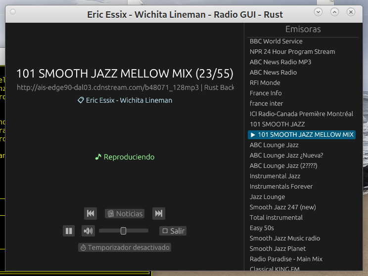
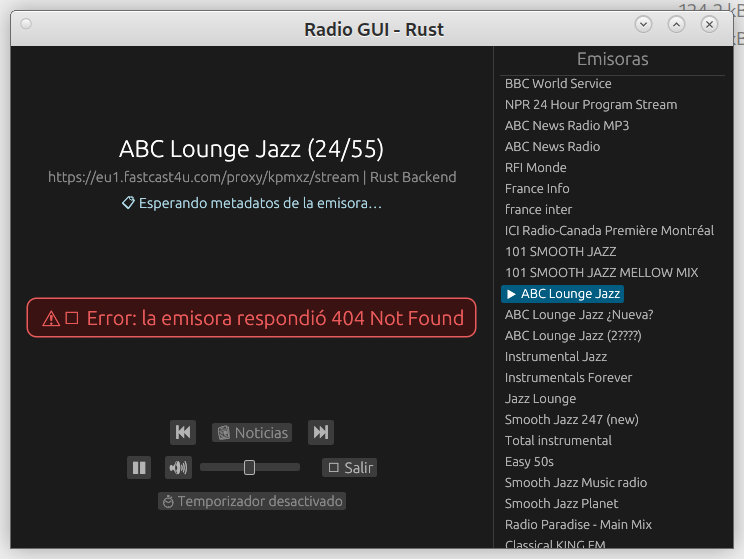
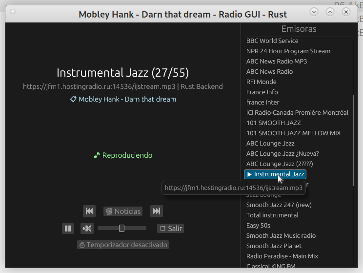
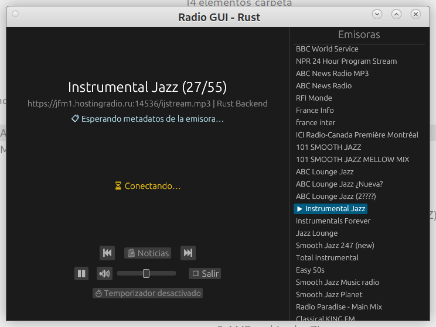
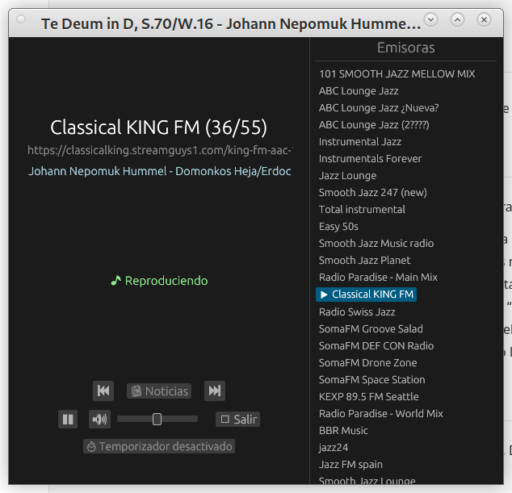
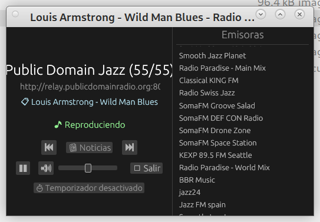

# radio-gui-rust

[](./LICENSE)

**Autor**: Angel de la Iglesia Gonzalo

**Versión/rev**: 1/0

**Fecha**: 20261102

**Summary:** An Internet radio receiver with a graphical user interface (GUI), written entirely in Rust. It plays MP3/AAC stations and HLS streams without relying on any external player: audio is downloaded, demultiplexed, and decoded natively within the application itself.


**Resumen**: Receptor de **radio por internet** con interfaz gráfica, escrito íntegramente en
Rust. Reproduce emisoras MP3/AAC y flujos HLS sin depender de ningún reproductor
externo: el audio se descarga, demultiplexa y decodifica dentro del propio
programa.

Este proyecto se ha generado con la ayuda de varias [*IA*](https://es.wikipedia.org/wiki/Inteligencia_artificial), con [*OpenCode*](https://opencode.ai/) y [*Big Pickle(\*)*](https://opencode.ai/docs/zen/) y con [*Google*](https://www.google.com/).

> **(\*) Nota**: *Big Pickle* es un modelo *stealt* (identidad de *IA* ocultada) que proporciona *opencode* gratuitamente durante un periodo indeterminado de tiempo (según indican sirve para el entrenamiento de la *IA* y su sistema). Los datos que maneja pueden ser transferidos fuera de la máquina por lo que no se debe permitir que maneje información personal o confidencial. La IA en *Big Pickle* puede cambiar de tiempo en tiempo (y lo puedes observar por el cambio de comportamiento cuando lleves unas cuantas sesiones con una *IA* y notes que las respuestas empiezan a tener un *aire* diferente).


## Características

- 🎧 **Reproducción nativa**: `rodio` para la salida de audio (ALSA en Linux,
  WASAPI en Windows), `symphonia` para decodificar MP3/AAC y `reqwest` para la red.
- 📻 **MP3, AAC/AAC+ y HLS**: además de emisoras directas, resuelve listas
  de reproducción (`.m3u` / `.pls`) y reproduce HLS (`.m3u8`) con *prefetch* de
  segmentos para encadenarlos sin cortes. Los flujos ADTS de Icecast (AAC+,
  `audio/aacp`) se normalizan para poder decodificarlos.
- 📶 **Reconexión automática** con backoff exponencial (500 ms → 5 s) ante caídas
  de red o cortes del servidor.
- 📋 **Lista de emisoras siempre visible** a la derecha: desplazable, redimensionable
  y con un clic para sintonizar. La emisora actual se resalta con `▶`.
- 🎚️ **Controles de reproducción**: pausa/reanudar, silencio y control de volumen.
- 🏷️ **Título dinámico**: el nombre del tema (metadatos ICY) se muestra en la barra
  de la ventana y en un rótulo desplazable.
- 📰 **Modo noticias automático** por franja horaria.
- ⏱️ **Temporizador de apagado** (15 → 30 → 60 → 120 min → OFF).
- 💾 **Persistencia**: recuerda la última emisora y el tamaño/posición de la ventana.
- 🖥️ **Ventana adaptable**: los controles permanecen centrados al redimensionar.

## El programa funcionando

Puedes ver ejemplos de la interfaz en el directorio [`assets/`](assets/):

| Vista | Descripción |
|---|---|
|  | Ventana principal con la lista lateral de emisoras (desplazable y redimensionable). |
|  | Aviso o estado de error/reproducción centrado (horizontal y verticalmente) entre los metadatos y los controles. |
|  | Estado "🎵 Reproduciendo" mientras la emisora suena correctamente. |
|  | Estado "⏳ Conectando…" mientras se resuelve la URL y se obtiene la primera trama. |
|  | Título/canción recibido vía metadatos ICY, con desplazamiento horizontal. |
|  | Ventana reducida al tamaño mínimo, con los tres bloques de controles centrados. |

## Descarga

Las versiones publicadas, para la ejecución del programa en Linux, incluyen la carpeta `distribucion/` lista para usar
(ejecutable + ficheros de configuración de ejemplo). Descarga el paquete desde la
sección [Releases](../../releases), descomprímelo y ejecuta `radio-gui-rust` desde
`distribucion/bin/`.

## Inicio rápido

1. Consigue el programa: descarga una versión publicada o [compílalo](#compilación).
2. Comprueba que, junto al ejecutable, están `emisoras.m3u`, `noticias.m3u` y
   `minutos_noticias.txt` (en `distribucion/bin/` ya vienen incluidos).
3. Ejecuta `radio-gui-rust`: se conectará a la última emisora guardada o, si no
   existe, a la primera de la lista.

## Interfaz

- **Panel central**: nombre de la emisora, URL, el rótulo de metadatos
  desplazable y, debajo, el **estado de reproducción** (Detenido / Conectando /
  Reproduciendo / Error), dibujado de forma explícita y centrado (horizontal y
  verticalmente) entre los metadatos y los controles.
- **Controles** (centrados en la parte inferior):
  - *Navegación*: Anterior · Noticias · Siguiente.
  - *Reproducción*: Pausa/Reanudar · Silencio · Volumen · Salir.
  - *Temporizador*: apagado automático.
- **Panel derecho**: lista completa de emisoras. Se desplaza si hay más de las
  que caben y su ancho se puede arrastrar con el ratón.
- **Avisos**: si falta algún fichero de configuración o no hay dispositivo de
  audio, se muestra un aviso en la parte superior (el programa sigue arrancando).
  Los errores de reproducción (emisora caída, sin conexión, formato no
  reconocido, lista no descargable…) se muestran de forma explícita, centrados
  entre los metadatos y los controles.

## Controles

| Tecla | Botón | Acción |
| --- | --- | --- |
| `A` | `⏮` | Emisora anterior (circular) |
| `S` | `⏭` | Siguiente emisora (circular) |
| `N` | `📰` | Activar/desactivar modo noticias |
| `T` | `⏱` | Temporizador de apagado (15 → 30 → 60 → 120 min → OFF) |
| `Espacio` | `⏸` / `▶` | Pausa / Reanudar |
| `M` | `🔇` / `🔊` | Silenciar / activar sonido |
| `ESC` | `🛑 Salir` | Cerrar la aplicación y detener la reproducción |

## Configuración

Todos los ficheros se leen desde la **carpeta del ejecutable**, de modo que la
distribución es portable.

| Fichero | Descripción |
| --- | --- |
| `emisoras.m3u` | Lista de emisoras en formato M3U (`#EXTINF:<duración>,<nombre>` + URL). |
| `noticias.m3u` | Emisora usada por el modo noticias (se toma su primera URL). |
| `minutos_noticias.txt` | Franja del modo noticias: 1.ª línea = minuto inicial, 2.ª línea = minuto final (p. ej. `00` y `06`). |
| `ultima_estacion.txt` | Índice de la última emisora escuchada; se actualiza al salir. También se acepta `última_estación.txt` para compatibilidad. |
| `radio_ui.ron` | Tamaño y posición de la ventana; lo genera la aplicación. |

Ejemplo de `emisoras.m3u`:

```m3u
#EXTM3U
#EXTINF:-1,Emisora N 1
https://Emisora_n1.m3u8
#EXTINF:-1,Emisora N 2
https://Emisora_n1.mp3
```

> **NOTA**: Aunque se especifica el formato *M3U* el fichero puede contener formato en *M3U8*.

## ¿Dónde encontrar la dirección de internet de las emisoras?

Para crear o modificar tus ficheros *.m3u* puedes utilizar numerosas páginas *web* que proporcionan direcciones (*URL*) de las emisoras. Las siguientes páginas *web* son un ejemplo:

* [radio-browser](https://www.radio-browser.info/)
* [Radio stream](https://streamurl.link/)
* [fmstream.org](https://fmstream.org)
* [Internet-Radio.com](https://Internet-Radio.com)

También puedes obtener las direcciones de internet de numerosas emisoras utilizando *play list* que puedes obtener de internet. Puedes encontrar listas enormes del tipo *m3u* o *m3u8* en:

* [TDTChannels](https://github.com/LaQuay/TDTChannels/tree/master)
* [ondaChannels](https://ondachannels.com/listas/)

> **NOTA**: Las listas que obtengo de los dos enlaces anteriores son identicas.

Otra lista muy grande de recursos multimedia la puedes obtener en:

* [iptv-org](https://github.com/iptv-org/iptv)

En este enlace puedes filtrar con varios creiterios, uno interesante es por idioma:

* [iptv-org por idiomas](https://github.com/iptv-org/iptv/blob/master/PLAYLISTS.md) (pulsar en *Expand*)

Si estás oyendo una emisora en su *web* y no te da el *link* a la emisora fácilmente, abre la consola de desarrollador en tu navegador *(F12)*, ve a la pestaña *Red (Network)* y filtra por *Media* o *XHR* mientras reproduces la radio. Deberías ver aparecer la *URL* del flujo de audio (aunque algunas veces es complicado porque las emisoras parecen querer ocultar el enlace directo).


## Compilación

Requiere una instalación de Rust estable ([rustup.rs](https://rustup.rs/)).

### Linux

1. Instalar dependencias (Debian/Ubuntu):
   ```bash
   sudo apt-get install -y build-essential pkg-config libasound2-dev
   ```

2. Compilar en modo release:
   ```bash
   cargo build --release
   ```

3. El ejecutable estará en `target/release/radio-gui-rust`. Cópialo junto a los archivos de configuración a `distribucion/bin/` o a la carpeta de destino.

### Compilación para Windows 11

El código es multiplataforma y compila sin modificaciones en Windows.

1. **Instalar Rust**: Descarga e instala [rustup.rs](https://rustup.rs/). Incluye el target `x86_64-pc-windows-msvc` por defecto.
2. **Instalar MSVC Build Tools** (con winget, incluido en Windows 11):
   ```powershell
 	winget install -e --id Microsoft.VisualStudio.2022.BuildTools `
--override `
"--passive --wait --add Microsoft.VisualStudio.Workload.VCTools --includeRecommended"
   ```
   Esto instala el compilador MSVC, el enlazador y el Windows 11 SDK necesarios para compilar dependencias como `ring`.
3. **Clonar/copiar el proyecto** a Windows (omite `target/` si lo copias desde Linux).
4. **Compilar**:
   ```powershell
   cargo build --release
   ```
5. **Empaquetar**: El binario `target\release\radio-gui-rust.exe` junto con `emisoras.m3u`, `noticias.m3u`, `minutos_noticias.txt` y `ultima_estacion.txt` forman una distribución portable. Colócalos todos en la misma carpeta para ejecutarlo. (También se admite `última_estación.txt` por compatibilidad con versiones anteriores.)

> **Nota para ejecución sin Visual Studio**: Si el equipo no tiene las runtime de C++, puedes instalarlas con: `winget install -e --id Microsoft.VCRedist.2015+.x64`

## Desarrollo

### Ejecutar tests
```bash
cargo test --release --bin radio-gui-rust -- --skip decode_sample_urls
```

### Comprobar con Clippy
```bash
cargo clippy --release
```

### Limpieza de artefactos
```bash
cargo clean
```
`target/` está en `.gitignore`, por lo que `cargo clean` no afecta a archivos versionados.

### Capturar logs a un fichero (efectos.txt)

Los mensajes de diagnóstico (`[net]`, `[dec]`, `[hls]`, etc.) se escriben en **stderr**, no en stdout. Para guardarlos:

```bash
./radio-gui-rust 2> efectos.txt
```

Importante: **no uses** `./radio-gui-rust > efectos.txt`, ya que eso redirige stdout (vacío) y dejará el fichero vacío. Usa `2>` para redirigir stderr. Los logs incluyen marcas de tiempo y son útiles para diagnosticar emisoras que no suenan.

## Publicación de versiones

Para sacar una versión nueva al estilo GitHub Releases (etiqueta + paquete descargable) existe el guión [`prepara_release.sh`](prepara_release.sh):

```bash
./prepara_release.sh --etiqueta
```

Compila en modo release, copia el ejecutable a `distribucion/bin/`, empaqueta la carpeta `distribucion/` en `dist/radio-gui-rust-v<versión>.zip` (más su suma `.sha256`) y crea la etiqueta git `v<versión>`.

**El ejecutable, el PDF y el zip no se versionan**: ocuparían ~22 MB por versión y harían crecer el repositorio sin límite. El repositorio guarda solo código y ficheros pequeños de configuración; el binario viaja dentro del `.zip` del release, que es lo que se adjunta en GitHub y lo que descarga el usuario final.

El procedimiento completo —incluida la transferencia del proyecto a otra máquina para subirlo a GitHub y la publicación del release— está documentado en [`RELEASING.md`](RELEASING.md).

## Licencia

Este proyecto está publicado bajo la **Licencia MIT**. Consulta el archivo [`LICENSE`](LICENSE) para más detalles.

## Contribuciones

Las contribuciones son bienvenidas. Puedes abrir issues para reportar bugs o sugerir mejoras, así como enviar pull requests.

## Notas técnicas

- **Backend de audio**: `rodio` (salida de audio multiplataforma: ALSA en Linux, WASAPI en Windows) + `symphonia` (decodificación MP3/AAC/HLS MPEG-TS).
- **ADTS AAC**: los flujos elementales ADTS se normalizan antes de decodificarlos: se encuadran las tramas (descartando la trama parcial inicial cuando la conexión empieza a mitad de emisión) y se convierte la sincronía MPEG-2 `0xFFF9` a MPEG-4 `0xFFF1`, que es la única que reconoce `symphonia`. Así suenan las emisoras `audio/aacp` (HE-AAC) de Icecast.
- **Networking**: `reqwest` con timeouts configurados para evitar bloqueos en streams muertos.
- **Reconexión**: Backoff exponencial (500ms → 5s) ante errores de lectura/red.
- **HLS**: Prefetch de segmentos para minimizar huecos entre segmentos consecutivos. Recarga automática de playlist *live*.
- **Cola de audio sin bloqueos**: la decodificación corre en su propio hilo y rellena una cola de PCM (~3 s) que consume la salida de audio, de modo que no se producen *underruns* aunque la red tenga ráfagas.
- **Logs**: En terminal se muestran logs con marca de tiempo `[net]`, `[dec]`, `[hls]` para facilitar diagnóstico.
